<!-- RISHABH PRAJAPATI · CYBERSECURITY PROFILE README -->

## 👤 About Me

<table>
<tr>
<td align="center" width="150">🛡️ <b>Role</b></td>
<td>Cybersecurity Researcher &nbsp;•&nbsp; Ethical Hacker &nbsp;•&nbsp; Web Developer</td>
</tr>
<tr>
<td align="center">🎯 <b>Focus</b></td>
<td>Web Security &nbsp;•&nbsp; Network Security &nbsp;•&nbsp; Penetration Testing &nbsp;•&nbsp; OSINT</td>
</tr>
<tr>
<td align="center">🐧 <b>Env</b></td>
<td>Linux &nbsp;•&nbsp; Kali Linux</td>
</tr>
<tr>
<td align="center">🚀 <b>Mission</b></td>
<td>Learn ➜ Research ➜ Build ➜ Secure</td>
</tr>
<tr>
<td align="center">📡 <b>Status</b></td>
<td>🟢 Online &amp; Learning</td>
</tr>
</table>

> 💬 *"Breaking systems to understand how to secure them."* — I blend **development** with **security** to build practical projects, experiment in controlled labs and solve CTF challenges.

| 🎯 Offense | 🔬 Research | 🛡️ Defense |
| :---: | :---: | :---: |
| Recon · Web & Network Security · Pentesting | Vuln Analysis · OSINT · CTFs · Automation | Monitoring · Hardening · Secure Dev |

## 🧰 Arsenal

  

## 🎯 Current Mission

| Skill | Progress | |
| :-- | :-- | --: |
| 🌐 Web Security | `██████████████████░░` | **90%** |
| 📡 Network Security | `████████████████░░░░` | **80%** |
| 🐧 Linux Security | `███████████████░░░░░` | **75%** |
| ⚔️ Penetration Testing | `█████████████░░░░░░░` | **65%** |
| 🔍 OSINT | `████████████░░░░░░░░` | **60%** |
| 🤖 Security Automation | `███████████░░░░░░░░░` | **55%** |

📚 <b>Also exploring:</b> Vulnerability Research · Digital Forensics · Secure Development

## 🚀 Featured Projects

| Project | Description |
| :-- | :-- |
| 🌊 **[BlueNexus](https://github.com/rishabhh077/BlueNexus-SIH-2026)** | 3D ocean visualization built for **Smart India Hackathon (SIH)** |
| 🔐 **[Password Strength Analyzer](https://github.com/rishabhh077/password_strength_analyzer)** | Analyzes password strength & promotes stronger authentication |
| 🔑 **[Password Manager](https://github.com/rishabhh077/password_manager)** | Secure handling and organization of credentials |
| 🧪 **[Security Research](https://github.com/rishabhh077?tab=repositories)** | Labs, CTFs and hands-on security experiments |

## 🏆 Achievements

## 📊 GitHub Analytics

<picture>
  <source media="(prefers-color-scheme: dark)" srcset="https://raw.githubusercontent.com/rishabhh077/rishabhh077/output/github-contribution-grid-snake-dark.svg"/>
  <source media="(prefers-color-scheme: light)" srcset="https://raw.githubusercontent.com/rishabhh077/rishabhh077/output/github-contribution-grid-snake.svg"/>
  
</picture>

> 🔐 **Ethics first:** all testing is done only on systems I own or am explicitly authorized to assess.

**BUILD • BREAK • UNDERSTAND • SECURE**

